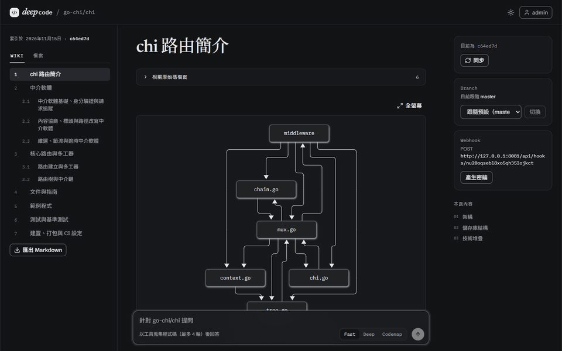
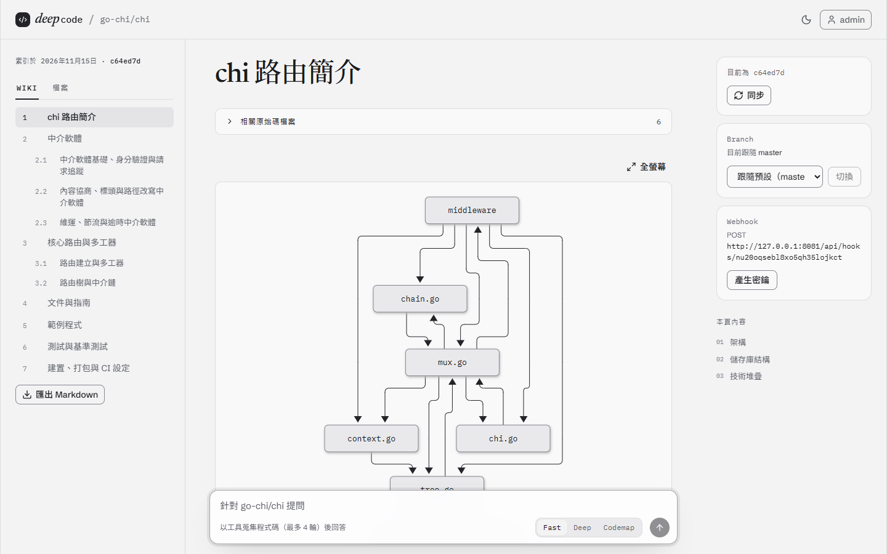
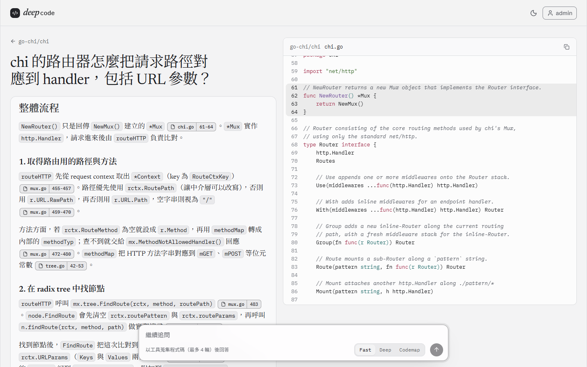
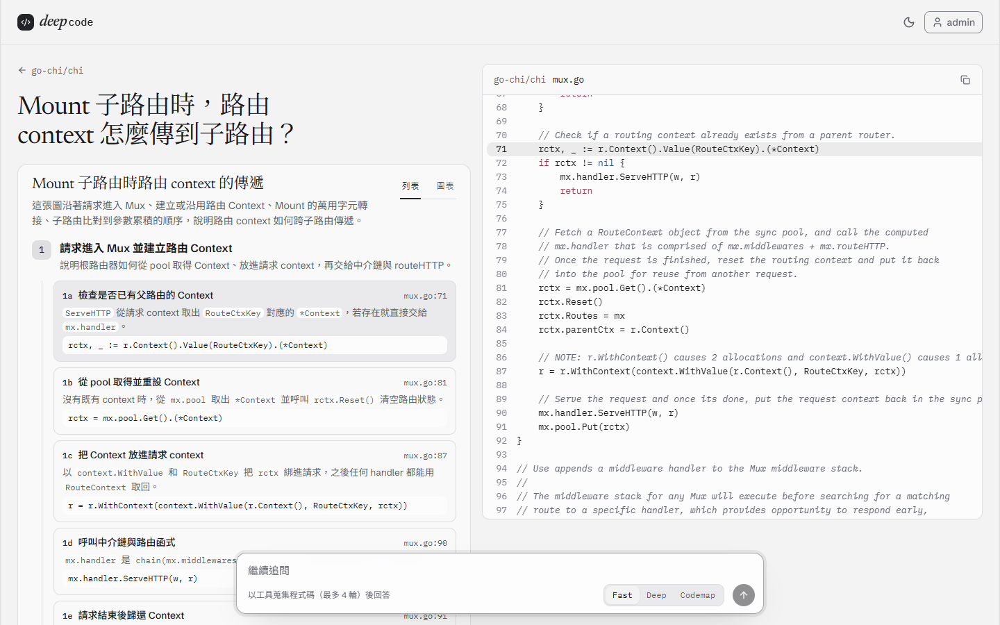

<div align="center">

# deepcode

**自架的程式碼 Wiki 與問答：讀懂任何 Repository，說明都引用到原始碼行號。**

[](https://github.com/aitay721822/deepcode/actions/workflows/ci.yml)
[](https://github.com/aitay721822/deepcode/releases)
[](#license)



</div>

從 GitHub、GitLab（含自架的 GitHub Enterprise 與 GitLab）匯入 Repository，建立 Symbol 與程式碼索引，生成附來源的 Wiki，並以 Hybrid Retrieval 回答程式碼問題。單一 Go 執行檔，內嵌 React 介面，SQLite 是唯一的資料庫。

## 特色

- **Wiki**：依程式結構生成兩層 Wiki，附架構圖，說明引用到原始碼的行號。新的 commit 由 webhook、定時同步（`sync_every`）或手動同步帶進來，只重寫受影響的頁。
- **問答**：三種模式。Fast 以工具搜集程式碼後回答；Deep 搜得更多，先讀相關的 Wiki 頁；Codemap 依執行順序畫出程式路徑。檢索結合全文、Symbol 與向量。
- **語言**：C#/.NET、Go、Java、JavaScript、TypeScript、Python、Rust。
- **權限**：RBAC（使用者、角色、權限）限制每個人能看到哪些 Repository；後台管理帳號、角色、Git 伺服器，並即時顯示背景工作的進度與 LLM 用量。
- **MCP**：6 個工具（讀 Wiki、搜尋程式碼、讀檔、問答），以個人 token 或 OAuth 接入代理程式。
- **自架**：資料庫與索引都在你的機器上；Chat 與 Embedding 接任何 OpenAI 相容的 API，自架的模型也行。

## 截圖

**Wiki**：兩層目錄、由 import 圖畫出的架構圖，右側是同步、branch 與 webhook。

<picture>
  <source media="(prefers-color-scheme: dark)" srcset=".github/assets/wiki-dark.png">
  
</picture>

**問答**：答案裡的每個引用都能點開，右側直接顯示那幾行原始碼。

<picture>
  <source media="(prefers-color-scheme: dark)" srcset=".github/assets/answer-dark.png">
  
</picture>

**Codemap**：把答案畫成依執行順序編號的程式路徑，可以切換成圖。

<picture>
  <source media="(prefers-color-scheme: dark)" srcset=".github/assets/codemap-dark.png">
  
</picture>

## Quick start

1. 從 [Releases](https://github.com/aitay721822/deepcode/releases) 下載 Windows amd64 的 `deepcode_<版本>_windows_amd64.exe`（`dev` 是 main 的最新開發版），或自行建置：

   ```bash
   scripts/build.sh
   ```

   建置需要 Go 1.27.1+ 並啟用 CGO（Tree-sitter 需要 C 編譯器）、Node.js `^20.19` 或 `>=22.12`、Bash。執行需要系統 `git` 2.31+。

2. 在執行檔旁建立 `deepcode.yaml`，填入 OpenAI 相容的 Chat API（語意檢索另需 Embedding API，可省略）。伺服器不必強制 JSON schema：schema 只是引導，每個回覆都由 deepcode 自己檢查、要求修正一次，剩下的由程式補正。schema 預設以 `response_format` 送出；伺服器不接受它，或要等整段 JSON 產生完才送出（例如 Strata）時，設 `chat_schema: prompt`，改把 schema 寫進系統訊息，回覆會逐字串流。

   ```yaml
   chat_base_url: http://host:8080/v1
   chat_api_key: your-key
   chat_model: your-chat-model
   # chat_api: completions  # 或 responses
   # chat_schema: server    # 或 prompt
   # embed_model: your-embedding-model
   # chat_context: 524288
   # chat_tokenizer: tokenizer.json
   ```

   每個鍵也可以用環境變數設定，例如 `DEEPCODE_CHAT_MODEL`，環境變數會覆寫檔案。

3. 啟動並開啟 <http://127.0.0.1:8080>：

   ```bash
   ./deepcode serve
   ```

   第一次啟動會建立管理員 `admin`，密碼取自 `DEEPCODE_ADMIN_PASSWORD`；未設定時會產生一次性密碼並印在 log。資料寫在 `./data`。`deepcode --help` 列出所有指令與旗標。

## 升級

1. 先備份資料庫：`./deepcode backup backup.db`，伺服器運作中也可以。
2. 停掉舊版，換上新的執行檔，再 `./deepcode serve`。資料庫在啟動時自動升級。
3. `secret_key`（`DEEPCODE_SECRET_KEY`）要沿用；沒設定時用的是 `data/secret.key`，這個檔要留著。換了 key，存下的 Git 伺服器 token 就解不開。

要退回舊版，換回舊的執行檔，並用升級前的備份取代資料庫：新版跑過的 migration 無法倒回。

## 相容性

1.0.0 起，以下只會新增，不會改名或移除；要移除的，會先在一個 minor 版本標為 deprecated 並在 log 警告，到 2.0 才移除：

- 設定：`deepcode.yaml` 的鍵、對應的 `DEEPCODE_*` 環境變數，以及 `DEEPCODE_CONFIG`。
- HTTP API 的路由，以及 MCP（`/mcp`）的工具和參數。
- CLI 指令 `serve`、`backup`、`passwd` 和它們的旗標。
- 資料庫：發佈過的 migration 不再修改，新版本只往前加；v0.1.0 的資料庫可以直接升級。

每一項都有測試守住清單（`TestFrozenSettings`、`TestFrozenRoutes`、`TestMCP`、`TestFrozenCommands`、`TestReleasedMigrations`），舊資料庫的升級由 `TestUpgrade` 驗證。

## License

MIT License

Copyright (c) 2026 chungyu.lin

Permission is hereby granted, free of charge, to any person obtaining a copy
of this software and associated documentation files (the "Software"), to deal
in the Software without restriction, including without limitation the rights
to use, copy, modify, merge, publish, distribute, sublicense, and/or sell
copies of the Software, and to permit persons to whom the Software is
furnished to do so, subject to the following conditions:

The above copyright notice and this permission notice shall be included in all
copies or substantial portions of the Software.

THE SOFTWARE IS PROVIDED "AS IS", WITHOUT WARRANTY OF ANY KIND, EXPRESS OR
IMPLIED, INCLUDING BUT NOT LIMITED TO THE WARRANTIES OF MERCHANTABILITY,
FITNESS FOR A PARTICULAR PURPOSE AND NONINFRINGEMENT. IN NO EVENT SHALL THE
AUTHORS OR COPYRIGHT HOLDERS BE LIABLE FOR ANY CLAIM, DAMAGES OR OTHER
LIABILITY, WHETHER IN AN ACTION OF CONTRACT, TORT OR OTHERWISE, ARISING FROM,
OUT OF OR IN CONNECTION WITH THE SOFTWARE OR THE USE OR OTHER DEALINGS IN THE
SOFTWARE.
